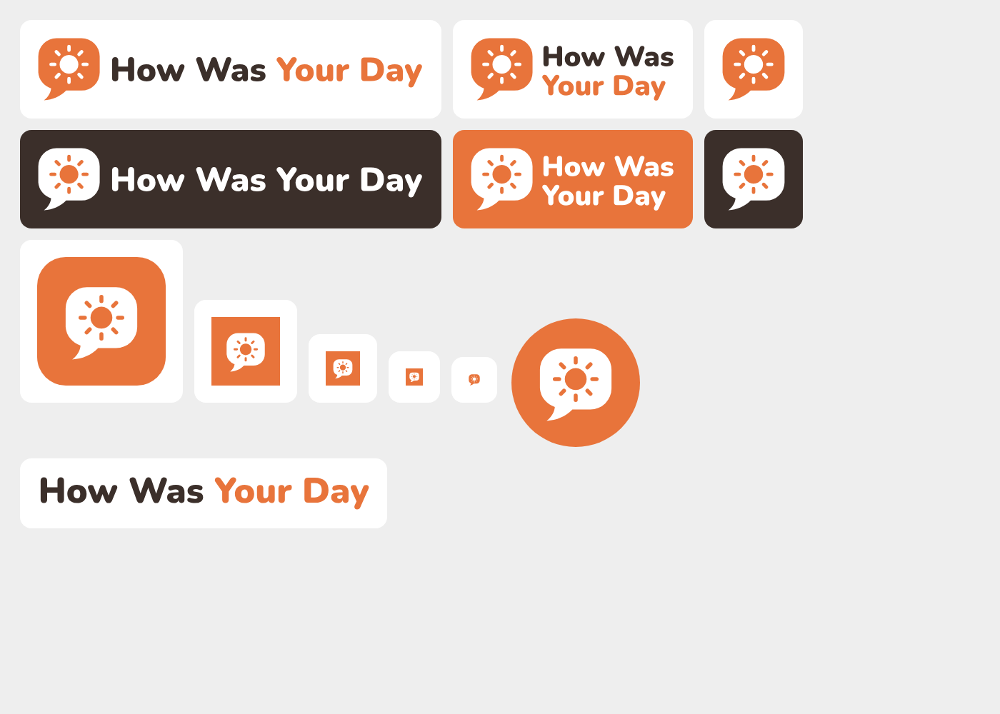

# How Was Your Day — logo



**The mark:** a rounded speech bubble (talking) holding a sun (your day). It sits next to the
wordmark *How Was* (ink) / *Your Day* (sunset orange), set in Nunito Black. All text is
outlined to vector paths, so the SVGs look identical everywhere and need no font installed.

## Colours (PROJECT.md §1a)
| Name | Hex | Use |
|---|---|---|
| Sunset orange | `#E8743B` | Bubble, "Your Day", app-icon background |
| Ink | `#3B2F2A` | "How Was" and dark backgrounds |
| White | `#FFFFFF` | Sun on the orange bubble, reversed logos |

## Files
| Need | Use |
|---|---|
| Website header, documents, decks | `svg/logo-stacked.svg` (compact) or `svg/logo-horizontal.svg` (wide) |
| On dark or orange backgrounds | `svg/logo-stacked-white.svg`, `svg/logo-horizontal-white.svg` |
| Avatar, small spaces, social profile | `svg/mark.svg` (`mark-white.svg` on dark, `mark-ink.svg` for one-colour print) |
| App icon: iOS, Play Store, PWA | `svg/app-icon.svg` (square, full bleed — the platform rounds the corners) |
| App icon shown as-is (slides, docs) | `svg/app-icon-rounded.svg` |
| Android adaptive icon | `svg/app-icon-foreground.svg` on the background colour `#E8743B` |
| Name only | `svg/wordmark.svg` |
| Raster versions | `png/` — transparent PNGs up to 2400px wide / 2048px square, app icons 16–1024px, `favicon.ico` |

## Rules
- Keep clear space around the logo of at least the height of the sun.
- Minimum size: the mark at 16px (favicon), the stacked logo at 32px tall.
- Don't recolour, stretch, rotate, outline or add shadows; don't put the orange logo on an orange background
  (use the white version).
- Never redraw the logo in a page with text or CSS — use `/brand/logo.png` or `/brand/*.svg`.

## Regenerate
Edit `generate-svg.cjs` (the single source of the drawing), then from the repo root:
```bash
npm i --no-save opentype.js@1.3.4 && node logo/generate-svg.cjs   # SVGs → logo/svg/
node logo/export.mjs   # PNGs → logo/png/, website (public/), Android icons + splash screens
```
`export.mjs` needs Playwright's Chromium (or `CHROME_PATH=/path/to/chromium`) and ImageMagick.
Then refresh the Play Store graphics with `OUT=docs/play node scripts/store-assets.mjs`.
